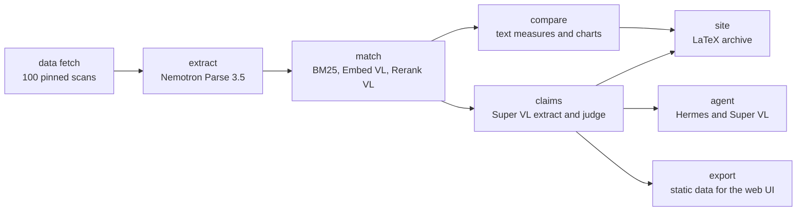

# Knowledge Across Time

**Live site: <https://knowledge-across-time.com>**

Panzerknacker's solution to the Nemotron Agentic AI Challenge.

We take 100 historical Encyclopaedia Britannica scans (1768 to 1860), read them with Nemotron Parse 3.5, match each entry to its closest English Wikipedia article with the required embedder and reranker, compare the two texts, and judge every Britannica claim against the modern article with Nemotron-3.5-Super-VL. A Hermes agent answers questions from the recorded evidence and cites both sources. Two websites present the results, and both are built from the same saved artifacts.

Current numbers: 98 of 100 scans produced text (232 entries). 76 entries matched 76 unique Wikipedia articles, and 156 entries stay unmatched and are reported. 421 claims are judged, 76 comparison pairs and 13 charts are recorded, and the archive holds 98 compiled LaTeX PDFs. The agent has 12 saved runs with six documented case studies. The test suite passes (188 tests).

## What we deliver

| Challenge item | Where it lives | Live |
|---|---|---|
| Interactive comparison site | `web/` (React, TypeScript, Vite) | <https://knowledge-across-time.com> |
| Static site with compiled LaTeX | `deliverables/website/`, sources in `artifacts/site/tex/` | <https://panzerknacker.ennio.vip> |
| Extracted Britannica entries | `artifacts/extract/` | |
| Article matches with full candidate evidence | `artifacts/match/`, LanceDB store | |
| Comparisons and charts | `artifacts/compare/` | |
| Claim alignments | `artifacts/claims/` | |
| Agent, tools, case studies | `integrations/hermes/`, `artifacts/agent/`, `docs/cases/` | |
| Evaluation report | `docs/evaluation.md`, `artifacts/evaluate/report.json` | |
| Submission pack | `docs/submission.md` | |

## Proof of succeeding on the deliverables

The participant brief scores six criteria for 100 points. This table lists every scored check and the evidence for it in this repository.

| Judging check | Points | How we met it |
|---|---|---|
| Completion of specs: Britannica extraction and archive | 4 | Parse 3.5 read 98 of the 100 scans into 232 entries, and the site stage compiles the sample into 98 LaTeX PDFs on a static website. |
| Completion of specs: Matching coverage | 4 | All 100 pages ran the pipeline, 98 produced text, 232 entries went through the matching funnel, and 76 entries matched unique Wikipedia articles. |
| Completion of specs: Comparison analysis | 4 | 76 comparison records compare the matched sources with token counts, distinctive terms, and 13 charts, and each claim cites exact quotes from Britannica and Wikipedia. |
| Completion of specs: Comparison agent and cases | 4 | The Hermes comparison agent ships in `integrations/hermes/` with six documented case studies, three classified success and three classified failure, each with its saved run under `artifacts/agent/runs/`. |
| Completion of specs: Submission | 4 | This repository carries the solution, both websites, the compiled LaTeX documents, the comparison analysis, and the case documentation, and the 3-minute video shows the successful and failed cases (script in `docs/video-script.md`). |
| Creativity: Originality | 10 | Beyond the starter: the claim-level comparison with its wrong, partly correct, and correct verdict scale, the scan-check tool that verifies stored quotes against the scan image, and a full-corpus mode over all 2,573 source scans. |
| Creativity: Value | 10 | On the live site a reader can search a topic, see the historical entry beside the modern article with every claim marked by verdict, and ask the agent for cited explanations. |
| Parse 3.5: Integration | 5 | Parse 3.5 runs on every selected scan through the shared endpoint, and its raw replies feed the extraction stage that derives the entries (`artifacts/extract/`). |
| Parse 3.5: Extraction fidelity | 5 | The derived text was checked against the scans, `artifacts/extract/qa/notes.json` lists OCR errors such as "Fractical Building" for "Practical Building", and the two unreadable scans stay reported as failures. |
| Parse 3.5: Structure preservation | 5 | The LaTeX documents keep the parse structure, with headword entries as sections, subsections in place, list items and captions rendered, and every block's class and bounding box stored. |
| Embedder and Reranker: Embedder | 5 | Nemotron Embed VL embeds each entry as a query and all candidate excerpts as documents (2,048-dimension unit vectors), and the similarity score keeps the best 8 candidates. |
| Embedder and Reranker: Reranker | 5 | Nemotron Rerank VL rescores the shortlists with raw logits, and that ranking decides the accepted match and the paragraph selection in the claims stage. |
| Embedder and Reranker: Combined workflow | 5 | Every candidate row keeps the BM25 score, the embedding similarity, and the rerank logit side by side (6,796 rows), so the funnel behind each of the 76 matches is inspectable. |
| Hermes extension: Working extension | 5 | We built four plugin tools beyond the starter, `challenge_search`, `challenge_compare`, `challenge_claims`, and `challenge_scan_check` (`integrations/hermes/`). |
| Hermes extension: Demonstrated benefit | 5 | Twelve saved runs show the tools working end to end, from an answer that reports both token counts with a Britannica and a Wikipedia citation to a scan check that flags a word the page image does not support. |
| Super VL: Integration | 5 | Super VL powers the Hermes agent through Token Factory and also runs the claims stage, the scan-check vision check, and the descriptions of the two failed scans. |
| Super VL: Comparison quality | 5 | The claims stage judged 421 claims across all 76 pairs (27 agree, 14 differ, 380 not covered in Wikipedia), and the site and the agent explain those differences claim by claim. |
| Super VL: Grounding | 5 | Every quote must be an exact substring of the stored source (129 claims were downgraded when their Wikipedia quote failed the check), and the strict citation check verifies each agent citation against the stored evidence. |
| Super VL: Failure handling | 5 | The agent answers "not stored" when evidence is missing, the two unreadable scans stay reported, and all twelve runs keep their classification in `artifacts/agent/report.json`. |

## How the whole thing works

Every stage is one command, and every stage reads the saved output of the stages before it. Raw model replies, derived text, and reports stay in separate folders under `artifacts/`. A stage never calls a model again for work that already ran, and a failed call stays a recorded failure instead of a guess.



The full record of method choices and run status is in [docs/method.md](docs/method.md). The next sections walk through each stage.

### Source data

`uv run nemotron-challenge data show` prints the fixed 100-scan manifest. `uv run nemotron-challenge data fetch` verifies the pinned Parquet file by SHA-256 and every scan checksum, then writes the scans to `data/raw/britannica/`. The manifest fixes the dataset revision, the sample rows, and the image checksums, so every team reads the same source. The Wikipedia side is a shared BM25 index over 7,182,883 articles from one pinned snapshot revision; no team downloads it. Details: [docs/wikipedia-api.md](docs/wikipedia-api.md).

### extract

One Nemotron Parse 3.5 call per scan. The scan goes to the service as an inline data URL (JPEG or PNG, below 8 MiB) with the starter instruction prompt at temperature 0. The raw reply lands in `artifacts/extract/raw/`, the derived entries in `artifacts/extract/derived/`. The extractor reads the Parse line-block markup (`<x_..><y_..>text<x_..><y_..><class_..>` per line) and keeps the class and the bounding box of every block.

Segmentation follows the v2 rules in [docs/parse-notes.md](docs/parse-notes.md). An entry starts at a Text block that opens with an inline upper-case headword (two or more capitals, followed by a comma or a period). `Page-header`, `Page-footer`, and `Page-number` blocks are page furniture and stay out of the entry text. `Title` and `Section-header` blocks merge into the parent entry as subsections. Text before the first headword becomes a fragment entry with no heading, and every parsed page keeps at least one entry. A continuation join across pages is conservative and never crosses a volume boundary in full-corpus mode.

Result: 98 of 100 scans produced text, 232 entries in total (135 headwords, 97 fragments). Two scans failed, page-0452 (a blank binding) and page-2243 (an engraved plate). Parse degenerates into a repetition loop on both, so the stage records them as failures in `artifacts/extract/coverage.json` and keeps the degenerate replies in `artifacts/extract/failures/`. Super VL writes a short image description for the two failed pages (`artifacts/extract/vl-fallback/`), and the archive index shows them. `run extract --derive-only` re-derives the segmentation from the saved raw replies without any model call.

### match

Each of the 232 entries runs a three-step funnel.

1. Candidates: the shared Wikipedia BM25 API returns the top 30 articles with 1,200-character excerpts. The query is built from the entry heading and its opening sentence, capped at 48 words and 512 characters. A fragment without a heading uses its eight rarest content words against the corpus.
2. Shortlist: Nemotron Embed VL embeds the entry text as a query and the candidate excerpts as documents (2,048-dimension unit vectors, batches of at most 16 items). The dot product keeps the best 8 candidates.
3. Verdict: Nemotron Rerank VL scores the shortlist from the entry text against each excerpt. Scores are raw logits. The best candidate at or above the accept threshold becomes the match. Below the threshold, the entry stays unmatched.

The accept threshold (`MATCH_LOGIT_THRESHOLD`, -5.5) comes from a 20-pair calibration sample: precision 0.35 overall, 0.67 on headword entries, 0.09 on fragments (`artifacts/match/calibration.json`). It was tuned on the hosted NIM relay, and the final runs use the team's pinned Nebius deployment, so recheck the value when the backend or the model revision changes.

Every candidate row keeps the BM25 rank and score, the embedding similarity, the rerank logit, and the accept or reject decision (`artifacts/match/evidence.jsonl`, 6,796 rows). Accepted pairs carry the article revision ID and text checksum (`artifacts/match/matches.jsonl`). Result: 76 of 232 entries matched 76 unique articles. 156 entries stay unmatched on purpose, and no later stage forces a match.

### compare

Each matched pair becomes one comparison record: the full Britannica entry text against the full Wikipedia article text. Text normalization folds long s and ligatures, lowercases runs of two or more letters, removes stopwords for counting, and logs every change. OCR errors and historical spelling are reported, not corrected in place. The measures are token counts, type/token ratio, top terms per side, distinctive terms by Laplace-smoothed log odds, and obsolete Britannica terms that never appear in the article. The stage writes 76 comparison records and 13 charts (`artifacts/compare/`).

### claims

For each matched pair, Super VL extracts up to eight atomic claims from the Britannica text. Every claim is a quote that must be an exact substring of the entry text; other proposals are dropped and counted. The Wikipedia article is split into paragraphs, embedded, and reranked, and the top three paragraphs become the evidence pool. Super VL then judges each claim against that pool and returns a verdict (`agrees`, `differs`, `contradicts`, or `not_in_wikipedia`), an exact Wikipedia quote, and a short explanation. A Wikipedia quote that fails the substring check downgrades the claim to `not_in_wikipedia`.

Result: 76 of 76 matched entries carry claims, 421 in total. 27 agree, 14 differ, 380 are not covered in the modern article, and 0 contradict. 129 claims were downgraded by the quote check. 18 model calls failed (timeouts) and stay listed in `artifacts/claims/failures.jsonl`; every affected entry still carries claims. Replies are cached by entry, article revision, and prompt hash, so a rerun skips finished work.

### agent

The agent is the Hermes Agent CLI with a challenge profile (`HERMES_HOME` at `data/hermes`, git-ignored) and the plugin in `integrations/hermes/nemotron-challenge`. The plugin gives the agent four tools:

- `challenge_search`: search the stored comparisons and return matching entries with article titles and match confidence. It uses the LanceDB evidence store when a backend URL is set, and the saved JSONL artifacts otherwise.
- `challenge_compare`: the comparison record for one entry, with claim alignments and source references.
- `challenge_claims`: the claim alignments for one entry with their evidence rows.
- `challenge_scan_check`: crop the quoted block from the scan image (bounding box from the Parse output) and ask Super VL to verify the quote against the page image.

The tools answer from stored records only. When the evidence does not cover a question, they say so and name the gap. Retrieved text is treated as data, never as instructions.

The runner (`src/nemotron_challenge/agent_runner.py`) sends scripted questions through `hermes chat -q <question> --toolsets nemotron_challenge` and records every run under `artifacts/agent/runs/<case_id>/` (command, answer, trace, session ID). A strict citation check then verifies each citation: cited entry IDs, Wikipedia URLs, and revision numbers must exist in the stored evidence, and an honest "not stored" answer counts as an admission of missing data. Twelve runs are kept. Six pass the strict check, and the rest stay in the record with their classification (`artifacts/agent/report.json`). Six case studies are documented in [docs/cases/](docs/cases/): three successes, one failure, and two scan-check cases.

### site

The site stage builds the archive and the PDFs from the saved artifacts. One LaTeX document per scan renders the segmented reading order: headword entries as unnumbered sections, subsections in place, fragments as "Continued from an earlier page", list blocks as `itemize`, and captions in italics. Tectonic compiles each document to PDF (put `tectonic` on PATH or keep it at `~/.local/bin/tectonic`). The stage then writes the HTML archive into `deliverables/website/`: `index.html` (all 100 scans with their status), 98 per-scan pages with the reading text next to the scan image and the PDF, `compare.html` with 76 pair pages and the charts, `cases.html` with the six case studies, and `limits.html`. The build record `artifacts/site/build.json` reports 98 pages, 98 PDFs, 0 compile failures, and 0 broken links.

### evaluate

One command assembles the evaluation report from the artifacts, with no model call: provenance (code revision, model IDs and revisions, dataset revisions, manifest SHA-256), coverage, matching, claims, comparison terms, the agent classification, every failed call per stage, the LanceDB table counts, and the pytest result. Output: [docs/evaluation.md](docs/evaluation.md) and `artifacts/evaluate/report.json`.

### export

One command writes the static app data that the web UI reads (`deliverables/website/app/data/`): `topics.json`, `meta.json`, `cases.json`, one `compare/<entry>.json` per entry, and `chat-recorded.json`, which replays the saved agent runs as chat replies. The shapes follow [web/API.md](web/API.md) and `web/src/api/types.ts`, so the same UI reads the static export or the FastAPI backend (`uv run uvicorn nemotron_challenge.api:app`). No model call happens at request time except `POST /api/chat`, which runs the same Hermes profile as the agent stage.

## Evidence and provenance

The repository keeps the promises the challenge asks for.

- Raw model replies, derived text, and reports stay separate (`artifacts/extract/raw/` against `derived/`, and the same pattern in every stage).
- Every record keeps its source reference: dataset revision, row, checksum, and, for Wikipedia, the article revision ID.
- Failed model calls are recorded with their error (`artifacts/extract/failures/`, `artifacts/claims/failures.jsonl`) and are never replaced by invented results.
- Retrieved article and scan text is data, not instructions (prompt-injection guard on both sides).
- The LanceDB store (`data/team.lancedb`) holds the evidence for retrieval: `artifact_provenance` (250 rows), `britannica_entries` (232), `wiki_articles` (76), `wiki_paragraphs` (2,674), and `match_evidence` (6,796), with full-text indexes. It is rebuilt from the saved JSONL artifacts, and vector columns fill on stage runs.

## The two websites

### Interactive site

`web/` holds the React, TypeScript, and Vite front end behind <https://knowledge-across-time.com>. It shows one topic at a time: the Britannica entry (as a summary, as the original Parse text, or as the page scan) beside the matched Wikipedia article. Claim verdicts use one colour scale (red wavy: wrong, yellow dashed: partly correct, green solid: correct), so "what changed" is readable at a glance. Further panels show the match confidence with its candidate table, vocabulary and coverage measures, and the agent, which answers questions with citations into both texts. Separate pages list the agent cases and the data and model sources.

Data comes from the pipeline. `run export` writes the app data in the shapes the UI expects, and the FastAPI backend serves the same routes from the artifacts for development. The deployed build serves the site as static files on Cloudflare and forwards `POST /api/chat` through a small Worker to the chat backend; until that backend URL is set in the Worker, the chat panel reports that the chat backend is not set up. The live build currently labels its article set "Demo data". Local setup: `npm install` and `npm run dev` in `web/`; see [web/README.md](web/README.md).

### Archive site

`run site` builds the static archive in `deliverables/website/`. It is deployed with the Dokploy app `website` (nginx image from `deploy/website/Dockerfile`) at <https://panzerknacker.ennio.vip>. The archive holds the 98 per-scan pages with their compiled LaTeX PDFs, the 76 comparison pages, the case studies, and the limits page. Rebuild the site and redeploy after new artifacts; `artifacts/site/build.json` lists the result.

## Run the pipeline

From the repository root on Linux with uv and Python 3.12:

```sh
uv sync --locked
cp .env.example .env        # endpoints and keys; keep this file out of Git
uv run nemotron-challenge doctor --live
uv run nemotron-challenge data fetch
uv run nemotron-challenge run extract
uv run nemotron-challenge run match
uv run nemotron-challenge run compare
uv run nemotron-challenge run claims
uv run nemotron-challenge run agent
uv run nemotron-challenge run site
uv run nemotron-challenge run evaluate
uv run nemotron-challenge run export
```

Re-derive the segmentation from the saved Parse replies without model calls with `uv run nemotron-challenge run extract --derive-only`.

Retrieval backends: the final runs use the team's Nebius deployment of the pinned embedder and reranker ([docs/model-service.md](docs/model-service.md), GPU receipt `artifacts/retrieval-gpu-smoke.json`). Without a GPU, `uv run nemotron-challenge gateway --port 8001` serves the hosted NVIDIA NIM models on the same contract ([docs/nim-gateway.md](docs/nim-gateway.md)).

### Every scan in the source

`--all` runs the same stages over all 2,573 rows of the pinned dataset. It uses `artifacts-full/` and `data/team-full.lancedb`, so the 100-scan deliverable is not touched. Calibrate the match threshold on the active retrieval backend first and read the runtime and cost notes in [docs/full-corpus.md](docs/full-corpus.md).

```sh
uv run nemotron-challenge data fetch --all
uv run nemotron-challenge run extract --all
MATCH_THRESHOLD=<calibrated> uv run nemotron-challenge run match --all
uv run nemotron-challenge run compare --all
uv run nemotron-challenge run claims --all
```

## Tests

```sh
uv run pytest
```

188 tests pass at the time of writing. The suite covers the data contracts, the service clients, and every stage with fixtures. Fixture tests prove that the setup behavior works; the real proof is the saved runs under `artifacts/`.

## Runs on

Linux with uv and Python 3.12. The team exercised every stage in a Linux container. Intel macOS is not a target: the pinned `lancedb==0.40.0` has no Intel macOS wheel.

## Documentation

- [docs/method.md](docs/method.md): every method choice and the run status.
- [docs/evaluation.md](docs/evaluation.md): the evaluation report.
- [docs/submission.md](docs/submission.md): the submission pack, versions, and limits.
- [docs/challenge.md](docs/challenge.md) and [docs/milestones.md](docs/milestones.md): the challenge brief and the stage guides.
- [docs/parse-notes.md](docs/parse-notes.md): the Parse output shape and the segmentation rules.
- [docs/wikipedia-api.md](docs/wikipedia-api.md): the shared search API.
- [docs/model-service.md](docs/model-service.md) and [docs/nim-gateway.md](docs/nim-gateway.md): the two retrieval backends.
- [docs/hermes.md](docs/hermes.md): the agent profile setup.
- [docs/full-corpus.md](docs/full-corpus.md): the full-corpus mode.
- [docs/cases/](docs/cases/): the six agent case studies.
- [web/README.md](web/README.md) and [web/API.md](web/API.md): the web UI and its data contract.
- [AGENTS.md](AGENTS.md): the working rules for this repository.

## Licenses

Original starter code uses [MIT](LICENSE). Data and model weights retain their source licenses. Read [ATTRIBUTION.md](ATTRIBUTION.md) before you share source material or model artifacts. The repository started from the organizer's GitHub template for the Nemotron Agentic AI Challenge.
